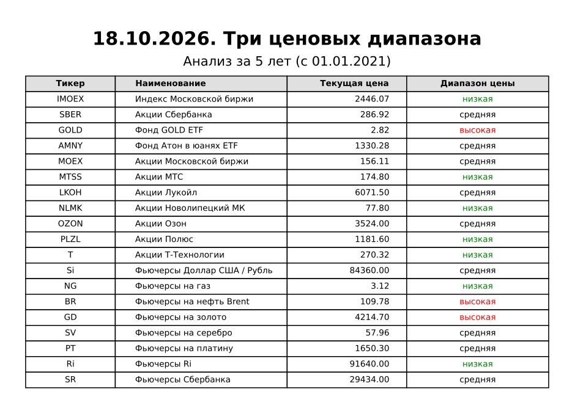
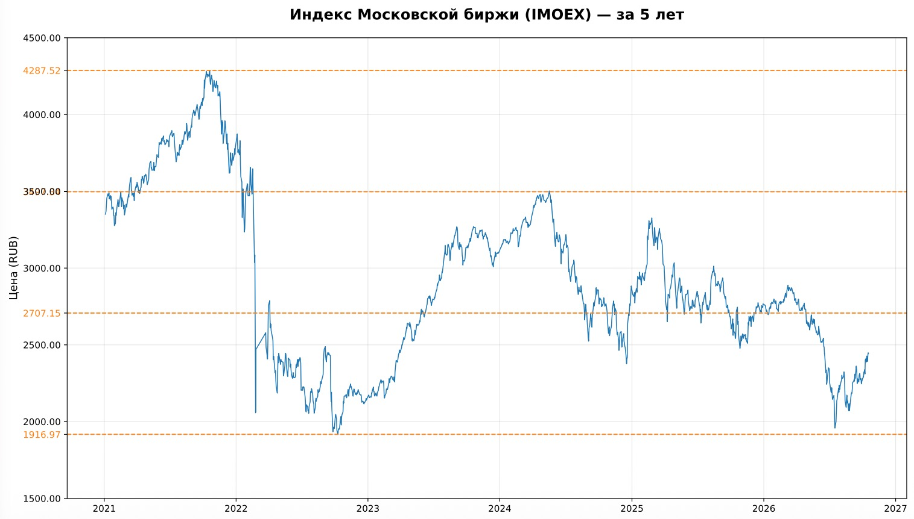

# Three Prices (3price)

**Any information generated by this software (its algorithms) does not constitute an individual investment recommendation. You make financial decisions on your own and at your own risk.**

*This software is provided "as is", without warranty of any kind, express or implied, including but not limited to the warranties of merchantability, fitness for a particular purpose, and noninfringement. In no event shall the authors or copyright holders be liable for any claim, damages, or other liability arising from, out of, or in connection with this software or its use.*

This code was created with the help of an LLM (Large Language Model) assistant.

A financial asset price analysis system: for each instrument it determines which
of the **three price ranges** its current price falls into, and builds a PDF
report with a summary table and charts.

## 🖼️ Report samples

<div align="center">


&nbsp; &nbsp; &nbsp; &nbsp;


</div>

The "Three Prices" logic is simple:

1. Closing-price history is taken for the analysis period — from January 1 of
   the year that began `YEARS` years ago to the present day.
2. Over this history the price minimum and maximum are computed; the
   `[min … max]` range is split into three equal parts by the levels
   `min + ⅓·range` and `min + ⅔·range`.
3. The current price (the latest available date) is classified:

   | Condition                 | Label                    | Color in the table |
   |---------------------------|--------------------------|--------------------|
   | price ≤ ⅓ of the range    | `низкая` ("low")         | green              |
   | price ≤ ⅔ of the range    | `средняя` ("medium")     | black              |
   | price above ⅔ of the range| `высокая` ("high")       | red                |

   If the data contains no valid price at all, a `—` label is set in gray.

The idea is a rough but vivid estimate of how "expensive" an instrument looks
relative to its own multi-year history, with no reference to fundamentals.

---

## Project layout

```
Три цены/
├── main.py           # entry point: orchestration only
├── config.py         # all configurable parameters and the asset list
├── log_setup.py      # logging setup and the startup banner
├── data_loader.py    # reads quotes from txt/ → {ticker: DataFrame}
├── analysis.py       # "three prices" levels and color labels (pure functions)
├── report.py         # PDF generation: title page, table, charts
├── txt/              # INPUT data — quote files (required before the first run)
├── logs/             # run logs (created automatically)
└── reports/          # ready PDF reports (created automatically)
```

> The project folder itself is named `Три цены` ("Three Prices" in Russian).

---

## Requirements and running

- Python **3.10+** (uses the `str | None`, `dict[str, ...]` syntax).
- Libraries: `pandas`, `matplotlib`:

  ```bash
  pip install pandas matplotlib
  ```

Run from the project folder:

```bash
python3 main.py        # the author's machine has Python 3.12 installed
```

What happens on start:

1. Run parameters are computed (dates, file names) — see `config.py`.
2. Logging is configured (file + console) and the startup banner is printed.
3. Quotes are read from the `txt/` folder and filtered by the start date.
4. Levels and range labels are computed for each ticker.
5. The PDF is written to `reports/`; the `logs/` and `reports/` folders are
   created automatically.

Return codes: `0` — the report was built; `1` — no ticker survived the
filtering (the log receives `[ERROR] Нет данных для сохранения в PDF…` —
"No data to save to PDF").

Console output example (the program prints its log messages in Russian;
they are shown here as-is):

```
[INFO] Успешно прочитан файл: SBER-d-5y.txt (354 строк начиная с 2019-01-01)
[ERROR] В файле T-d-5y.txt не найдены колонки даты или цены. Доступные: ['foo', 'bar']
[INFO] Проанализировано: 3 тикеров

================================================
[2026-10-18 14:33:36] 🚀 Запуск системы "Три цены" 3price.
================================================
[2026-10-18 14:33:36] ✅ Готово: 2026-10-18-3price-7.pdf — сохранён в папке reports
```

(Log lines go to both the file and the console; the order in the example may
differ due to stdout buffering when the output is redirected.)

---

## Modules

### `main.py` — entry point

Sequence of steps: `build_run_params()` → `setup_logging()` → `write_banner()`
→ `load_data()` → `build_price_maps()` → early exit with code 1 if the data is
empty → `generate_pdf()` → the final "Done" line written to the log and console.
The module is safe to import — no code runs on `import main`.

### `config.py` — configuration

All project constants and the `ASSETS_CONFIG` asset dictionary. The
`build_run_params()` function assembles `RunParams` (a named set of run
parameters: `years`, `today_str`, `pdf_filename`, `log_filename`, `start_date`)
and has no other side effects. The period start date is computed as
`January 1 (current year − YEARS)`.

### `log_setup.py` — logging

- `setup_logging(logs_folder, log_filename)` — creates the logs folder, sets up
  simultaneous output to a file (UTF-8) and the console in the
  `[LEVEL] message` format, and returns the path to the log file.
- `write_banner(log_path)` — the startup banner "🚀 Запуск системы "Три цены""
  ("Three Prices system starting"), written to the log **without** the standard
  logging prefix.

### `data_loader.py` — data loading

- `load_data(txt_folder, assets_config, start_date)` — the main function;
  returns `{ticker: DataFrame}` with the `begin` (date) and `close`
  (closing price) columns.
- `_extract_ticker(file_name)` — the ticker from the file name: everything
  before the `-d-5y.txt` or `-all-d.txt` suffix (e.g. `SBER-d-5y.txt` → `SBER`).
- `_parse_price_file(file_path)` — reads a single file:
  - the separator is detected automatically (`sep=None, engine='python'`), so
    TAB, comma, and semicolon all work;
  - column names are lowercased and angle brackets are stripped
    (`<DATE>` → `date`);
  - the date column is looked up among the candidates `begin`, `date`,
    `timestamp`, `time`; the price column — among `close`, `last`, `price`;
  - dates are parsed with `pd.to_datetime`, prices with `pd.to_numeric`; rows
    with NaN are dropped, the data is sorted by date, prices are rounded to
    2 decimal places.

Rules for handling problem files (the system never crashes on a single file):

| Situation | Reaction |
| --- | --- |
| The ticker is not in `ASSETS_CONFIG` | the file is **silently** skipped |
| Date/price columns not found | `[ERROR] … не найдены колонки даты или цены. Доступные: [...]` ("date or price columns not found. Available: [...]") |
| Other read/parse error | `[ERROR] Ошибка обработки <файл>: <текст>` ("error processing <file>: <text>") |
| Empty after the date filter | `[WARNING] Файл … не содержит данных после …` ("file … contains no data after …") |

If both files exist for the same ticker (`*-d-5y.txt` and `*-all-d.txt`), both
will be read, and the **last** one read wins — i.e. the `*-all-d.txt` file
(the patterns are iterated in that order). Keep only one file per ticker in
`txt/` so you don't have to guess which data made it into the report.

### `analysis.py` — levels and labels

Pure functions without I/O, easy to cover with tests:

- `compute_levels(df)` → `(min, min+⅓·range, min+⅔·range, max)` — the **only**
  levels formula in the project; it is used both by the labels and by the
  dashed chart lines.
- `classify_price(current_price, levels)` → `(label, color)` — the rule from
  the table above; the ⅓ and ⅔ boundaries belong to the lower/middle range.
- `build_price_maps(data_dict)` → `(price_level_map, price_color_map)` — labels
  and colors for all tickers at once.

### `report.py` — PDF report

- `generate_pdf(pdf_path, ...)` — the public entry point: a title page, then
  one page per ticker **strictly in `ASSETS_CONFIG` order**.
- `_render_title_page(...)` — a header with the date and period, the table
  `Тикер / Наименование / Текущая цена / Диапазон цены` ("Ticker / Name /
  Current price / Price range"); the text in the last column is colored
  green/black/red/gray according to the analysis results.
- `_render_ticker_chart(...)` — the price chart as a colored line; the
  `min, ⅓, ⅔, max` levels are shown as an orange dashed line (`--`), and the
  same values are highlighted in orange on the Y axis.
- `plural_years(n)` — Russian declension of "год/года/лет" ("year/years") with
  the 11–14 exceptions (one function for the whole project — used on the title
  page and in chart titles).
- `assign_chart_colors(...)` — line colors are handed to tickers round-robin
  from `BASE_COLORS` in `ASSETS_CONFIG` order.

---

## Configurable parameters

All parameters are collected in **`config.py`** (plus two presentation
constants in `report.py`). These are the only things you need to change.

### `config.py`

| Parameter | Default | What it controls |
| --- | --- | --- |
| `YEARS` | `5` | Analysis depth in years: the period "from January 1 (current year − YEARS)". Affects data filtering, the title-page subtitle, chart titles, and the PDF name (`…-3price-N.pdf`). |
| `TXT_FOLDER` | `'txt'` | Folder with the input quote files. |
| `LOGS_FOLDER` | `'logs'` | Folder for logs (created automatically). |
| `REPORTS_FOLDER` | `'reports'` | Folder for PDF reports (created automatically). |
| `ASSETS_CONFIG` | 19 tickers | **The main asset list** — see below. |

### `ASSETS_CONFIG` — the asset list

A dictionary of the form:

```python
'SBER': {'name': 'Акции Сбербанка', 'currency': 'RUB'},
```

- The key is the **ticker**, which must exactly match the file-name prefix in
  `txt/` (case matters: `Si` ≠ `SI`).
- `name` — a human-readable name for the table and chart titles.
- `currency` — the Y-axis label of the chart (`Цена (RUB)` / `Цена (USD)` —
  "Price (RUB/USD)"). Currency conversion is **not performed**: the `NG`,
  `BR`, `GD`, `SV`, `PT` futures are shown in dollars, as they appear in the
  data.

**How to add an asset:** add a line to `ASSETS_CONFIG` and put a
`TICKER-d-5y.txt` or `TICKER-all-d.txt` file into `txt/`. To remove an asset
from the report — delete its line from the dictionary (the file in `txt/` is
then simply ignored).

The order of the dictionary keys is the order of the table rows on the title
page and the order of the chart pages.

### `report.py` (presentation constants)

| Parameter | What it controls |
| --- | --- |
| `LEVEL_COLOR = '#ff7f0e'` | The orange color of the dashed levels and of the level labels on the Y axis. |
| `BASE_COLORS = [...]` | A palette of 10 line colors; with more tickers the colors repeat cyclically. |

### Computed automatically (not configurable)

- `start_date` — January 1 of the year `YEARS` years ago;
- the PDF name — `YYYY-MM-DD-3price-N.pdf`, by the run date;
- the log name — `YYYY-MM-3price.log`, by the run month;
- the range-label colors (green/black/red/gray) — hardcoded in
  `analysis.classify_price` and `_render_title_page`.

---

## Input data format

Files are copied into the `txt/` folder with the names `TICKER-d-5y.txt` or
`TICKER-all-d.txt`. The format is a text CSV with any separator; two columns
are required — the date and the closing price (from the candidates listed in
the `data_loader.py` description). A typical terminal export file:

```
<DATE> <CLOSE>
2020-01-06 100.00
2020-01-13 101.50
...
```

Content requirements:

- dates — in any format understood by `pandas.to_datetime` (`2020-01-06`,
  `06.01.2020`, `20200106`, etc.);
- prices — numbers; rows with empty/non-numeric values are dropped;
- enough data from `start_date` — everything earlier is filtered out, but if
  not a single row survives the filter, the ticker will not appear in the
  report (a `[WARNING]` is logged);
- data older than `start_date` in the file does no harm — it is cut off at
  load time.

Ticker data files can be downloaded using the `download_moex` program. Then
copy them into the `txt` folder of this project.

## Output files

### `reports/YYYY-MM-DD-3price-N.pdf`

- Page 1 — the title: a header with the date, the subtitle "Analysis for N
  years (from …)", and the table of all tickers with the current price and the
  colored range label.
- Then one page per ticker (in `ASSETS_CONFIG` order): the price chart for the
  period with orange dashed `min / ⅓ / ⅔ / max` levels.

### `logs/YYYY-MM-3price.log`

The full journal of runs for the month: startup banners, file-reading lines
(how many rows were read and from which date), errors and warnings, and the
final "✅ Готово" ("Done") line. The log is appended on every run.

---

## Troubleshooting

| Symptom | Cause and what to do |
| --- | --- |
| `[ERROR] Нет данных для сохранения в PDF` ("No data to save to PDF", return code 1) | There are no files in `txt/` with tickers from `ASSETS_CONFIG`, or the folders are not being created — check that you run from the project folder and that the file names match the tickers. |
| `…не найдены колонки даты или цены. Доступные: ['foo', 'bar']` ("date or price columns not found") | The file has no column with an expected name — rename the column (`<DATE>`/`<CLOSE>`, etc.) or add your own candidate to the `_parse_price_file` list in `data_loader.py`. |
| `Файл … не содержит данных после ГГГГ-ММ-ДД` ("file … contains no data after YYYY-MM-DD") | The file has no quotes for the analysis period — download a longer history. |
| The ticker is in `txt/` but did not appear in the report | The ticker was not added to `ASSETS_CONFIG`, or the name/case does not match (`Si` ≠ `SI`), or the ticker has a competing `*-all-d.txt` file that overrode the data. |
| `ModuleNotFoundError: pandas` | Run with the wrong interpreter: the libraries are installed into a specific Python (on the author's machine — `/usr/local/bin/python3.12`). |
